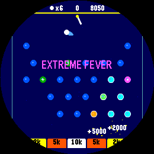
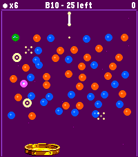
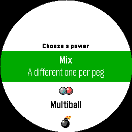
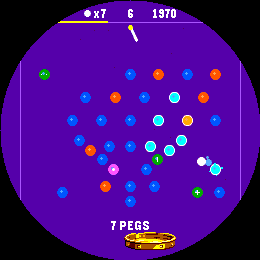
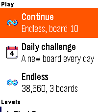

# pegble

A Peggle-style pachinko game for Pebble, written in C using the Pebble SDK.
Fire balls down through a field of pegs, clear every orange peg before you run
out, and finish in a fever. On the store as **Peggle**.

<p align="center">
  
  
  
</p>
<p align="center">
  
  
</p>

## Gameplay

- **Twelve hand-built levels**, an **Endless** run that gets harder board by
  board, and a **Daily challenge**: one board a day, the same for everyone.
- Four peg colours, and each one always means the same thing:
  - **Blue** — ordinary pegs, worth a little.
  - **Orange** — clear every one of them to finish the board.
  - **Pink** — the roaming bonus peg, worth a pile of points. It moves to a
    fresh blue peg every turn.
  - **Green** — a power peg. The mark in the middle says which power it holds.
- **Extreme Fever.** Light the last orange peg and everything slows down, then
  the bottom of the board turns into five bonus buckets — 2k, 5k, **10k**, 5k,
  2k. Every ball still in play lands in one.
- **Five powers**, unlocked one per level cleared:
  - **Multiball** — the ball splits (three ways on Pebble Time 2 and Round 2).
  - **Blast** — every peg in range lights at once.
  - **Fireball** — the ball burns straight through pegs for a few seconds.
  - **Spooky** — the next time it drops off the bottom it comes back in at the top.
  - **Magnet** — it's pulled towards the bucket on the way down.

  Before a level or an endless run, pick one power for every green peg, or
  **Mix** for a different one on each.
- **Combos and style shots.** Light 5 or more pegs in one shot for a combo
  bonus that grows fast. A **Long Shot** (an orange peg after a long fall) and
  **Off the Wall** (an orange peg straight off a side wall) pay extra.
- **Board furniture** in the later levels and deep into endless: **bumpers**
  that kick the ball away harder, rows that **slide** side to side, and
  **portals** that send the ball across the board.
- A moving golden **bucket** patrols the bottom edge — catch a ball in it for a
  free one.
- **Stars**: one for clearing a level, two and three for beating its pars.
- **Endless** gets harder as you go: more orange to clear, fewer power pegs,
  a quicker bucket, a smaller ball refund, and new furniture every few boards —
  bumpers from board 5, a sliding row from 7, portals from 10.
- **Sixteen trophies** and a page of lifetime stats.
- **Pick up where you left off.** Leave mid-game and Continue brings the run
  back between shots. The launcher says what's waiting: your paused run, or
  today's daily.
- **Timeline pins** for a finished daily and a new endless record.
- **Feel it on the wrist**: free balls, blasts, style shots, fevers and
  trophies each have their own vibration.
- Every level plays on its own coloured table, and Endless moves to a new one
  each board. Round and rectangular screens both supported; black-and-white
  watches tell pegs apart by shape instead of colour.

### The original Pebble and Pebble Steel

These have a quarter of the memory of later watches, so they get a lighter
game: the original six levels with fever, combos, stars, the daily, endless and
saved runs, but no levels 7–12 or furniture, no power picker (powers come as a
mix), no trophies or stats page, and no timeline pins.

## Controls

Up/Down aim, Select fires, and Select dismisses the results panel (or retries).

On watches with a touchscreen you can also drag anywhere on the board to aim,
lift your finger to fire, and tap the results panel to move on. The menus
scroll and select by touch too, provided touch navigation is switched on in the
watch's own settings.

## Building & running

```sh
pebble build                          # all targetPlatforms
pebble install --emulator gabbro      # round Pebble Round 2 emulator
pebble install --phone <ip>           # a paired phone
```

## Testing

The rules (`src/c/play.c`, `levels.c`, `progress.c`) have no drawing in them,
so they also build on a Mac against a stub `pebble.h`:

```sh
tools/host/run.sh test                     # the full check suite
PLATFORM=aplite tools/host/run.sh test     # the same for the original Pebble's game
tools/host/run.sh par 800                  # recompute the star pars
tools/host/run.sh winrate 300              # per-level difficulty check
```

It plays thousands of random-aim games per level on three screen sizes and
checks layouts, fevers, stuck balls, the daily's determinism, saved runs, and
that v2 save data carries over. Debug build flags for the emulator (boot
straight into a screen, autoplay, a one-orange-left fever demo) are listed in
`wscript` and `CLAUDE.md`.

## Target platforms

`targetPlatforms` in `package.json` controls which watches you build for:
**emery** (Pebble Time 2), **gabbro** (Pebble Round 2), **flint** (Pebble 2
Duo), and the originals — **aplite**, **basalt**, **chalk** and **diorite**.

## Project layout

```
src/c/           the watchapp (CLAUDE.md has a file-by-file map)
src/pkjs/        phone side of the timeline pins
resources/       the menu icon and the PixelLab icons and bucket
art/             the PixelLab originals; tools/make_icons.py and tools/make_bucket.py
                 turn them into resources
tools/host/      the Mac test harness
tools/shot.py    emulator screenshots via the QEMU monitor
screenshots/     the images in this README
```

## Documentation

Full SDK docs, tutorials, and API reference: <https://developer.repebble.com>
